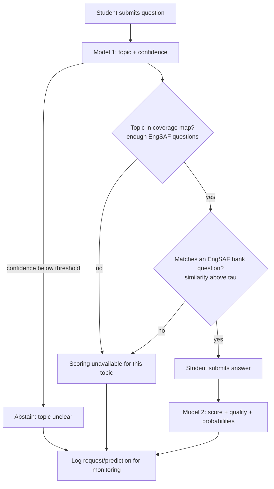

# PRD: AI-Powered Study Assistant for Engineering Students

**Status:** Draft v0.1 · **Type:** ML + MLOps project (not a frontend product) · **Team:** 4 members

> **How to read this document.** Dataset statements are tagged **[Confirmed]** (read from the Hugging Face dataset pages on 12 Oct 2026) or **[Verify]** (assumption the team must check in Week 1). No model performance numbers are claimed anywhere; all numeric targets are *proposed* and are ratified only after baselines exist.

---

## 1. Project Overview and Problem Statement

Engineering students rarely get fast, consistent feedback on short written answers. This project builds a small system that (a) predicts the topic of a student's question and (b) scores a student's short answer against a reference answer, learned from human-graded examples.

The main deliverable is a **reproducible MLOps lifecycle** around two trained models: versioned data, tracked experiments, automated tests and CI, a containerised API, monitoring and a gated release process.

**Core risk to manage:** the two datasets come from different worlds. Stack Exchange is Computer Science / Data Science / Political Science Q&A. EngSAF is exam answers across several engineering subjects. A topic classifier saying "operating systems" does not prove that the scorer can grade an answer on that topic. The design below treats this as a first-class problem.

## 2. Objectives and Measurable Success Criteria

| # | Objective | Success criterion (proposed targets, ratify after baselines) |
|---|---|---|
| O1 | Model 1 predicts question topic | Macro-F1 beats a majority-class and a keyword baseline by a margin the team fixes before touching the test set (starting target: macro-F1 ≥ 0.70 on coarse topics) |
| O2 | Model 1 abstains when unsure or out of domain | ≥ 90% of held-out out-of-domain questions (e.g. Political Science) rejected; abstention rate on in-domain test reported |
| O3 | Model 2 scores answers (0/1/2) | Macro-F1 and Quadratic Weighted Kappa beat a majority baseline and a cosine-similarity-threshold baseline; per-class recall reported |
| O4 | Model 2 is judged on unseen questions | Results reported separately for (a) the provided test split and (b) a question-held-out split; the gap is documented, not hidden |
| O5 | Pipeline is reproducible | A teammate can run `dvc repro` on a clean clone and reproduce the metrics within a stated tolerance |
| O6 | Lifecycle is demonstrated end-to-end | CI green, model served from Docker, monitoring report generated, one candidate model promoted or rejected through the documented gate |

## 3. Scope and Exclusions

**In scope:** two trained models, coverage analysis, integration logic, MLflow/DVC/CI, FastAPI + Docker serving, Evidently-based monitoring reports, model card and limitations.

**Out of scope:** production frontend (a CLI or Swagger UI is sufficient), user accounts, feedback-text generation, a third trained model, cloud autoscaling, automatic retraining triggers (see §6, stage 11).

**LLM fallback (investigation only).** An LLM API may be studied for unsupported topics, as a separate document: limitations, cost per request, evaluation plan (it must be scored on the *same* EngSAF test set before any claim), data-privacy and integration boundary. It is **not** a trained model of this project and is not wired into the default path.

## 4. The Two Models and Datasets

### 4.1 Dataset facts

| | Stack Exchange (`habedi/stack-exchange-dataset`) | EngSAF (`IsmaelMousa/engsaf`) |
|---|---|---|
| Size | **[Confirmed]** 82,158 rows, one `train` split, 103 MB | **[Confirmed]** ~5.58k rows: train 4,740 / val 338 / test 506 |
| Columns | **[Confirmed]** `id`, `title`, `body`, `tags`, `label` | **[Confirmed]** `question`, `student_answer`, `reference_answer`, `mark_scheme`, `score`, `rationale` |
| Content | **[Confirmed]** Questions from Computer Science, Data Science and Political Science Stack Exchange up to May 2021 (per card: `cs`, `ds`, `p` files) | **[Confirmed]** Real engineering exam short answers; paper: arXiv 2407.12818 |
| Target | `tags`, a string (no topic column exists) | `score` is an integer in {0, 1, 2}; `mark_scheme` maps 0 = incorrect, 1 = partially correct, 2 = correct |
| Distinct questions | n/a | **[Confirmed]** ~107–108 distinct questions in the viewer (card text says 119 in the raw data) |
| Licence | **[Confirmed]** Hub tag `cc-by-4.0`. **[Verify]** the underlying Stack Exchange content has its own terms (attribution/share-alike); read them | **[Confirmed conflict]** Hub tag says `apache-2.0`, but the card text says *academic and research use only, no commercial use or redistribution without permission*. Treat the stricter statement as binding unless the authors clarify |

### 4.2 Known problems the team must handle (confirmed from the pages)

1. **`label` in Stack Exchange is "resolved / not resolved", not a topic.** Do not use it as a target.
2. **Tags are one space-separated string, and many tags contain spaces** (e.g. `formal languages`, `time complexity`, `operating systems`). Splitting on spaces is wrong. Build a phrase vocabulary (longest-match) or a keyword-to-topic mapping and review it manually.
3. **Bodies are HTML** (`
`, `<code>`, math markup). Strip before vectorising.
4. **The Hub viewer shows no column saying which site a row came from.** **[Verify]** whether `cs`, `ds` and `p` are all in the default config and whether the source can be recovered. If it can, Political Science rows become useful **out-of-domain negatives** for abstention testing.
5. **EngSAF has no subject/topic column.** Topic coverage must be created by manually labelling its ~107 distinct questions with the same taxonomy as Model 1. A first-page preview shows mixed subjects (operating systems, hydrology, image processing, manufacturing, C++, statistics, finance, machine learning, cryptography) **[Verify with a full profile]**. Many have no Stack Exchange equivalent.
6. **Only ~107 distinct questions.** Models can memorise question-specific wording. Reference answers are also one per question.
7. **Leakage.** The Hub version was re-split by the dataset author using embedding similarity; it was *not* grouped by question. **[Verify]** how many val/test questions also appear in train. If most do, the provided test score measures "new answers to known questions", not generalisation.
8. **`rationale` is the grader's feedback and is derived from the label.** It must never be a model input. Some rationales may be machine-generated **[Verify]**.

### 4.3 Model 1: Question Topic Classification

- **Input:** cleaned `title` + `body`. **Output:** topic, confidence, and an `abstain` flag.
- **Taxonomy:** 8–12 coarse topics (e.g. algorithms, operating systems, databases, ML/data science, theory of computation, networks, security/crypto, programming languages). Defined in a versioned `topic_map.yaml` (tag phrase → topic). Questions whose tags map to several topics: keep only if one topic dominates, otherwise drop from training and log the count.
- **Approach:** TF-IDF + Logistic Regression (baseline) vs Linear SVM; calibrate probabilities (e.g. `CalibratedClassifierCV`); abstain below a threshold chosen on the validation set. Only decide the final strategy after the class-distribution analysis.
- **Metrics:** macro-F1, per-class precision/recall, confusion matrix, calibration curve, abstention-vs-accuracy trade-off.

### 4.4 Model 2: Student Answer Evaluation

- **Input:** question, student answer, reference answer. **Output:** predicted score {0,1,2} + quality label (incorrect / partial / correct) + class probabilities.
- **Approach:** Sentence-Transformer embeddings of student and reference answers → features (cosine similarity, |u−v|, u⊙v, length ratios) → Logistic Regression baseline, then XGBoost. Choose classification vs ordinal regression after reviewing the score distribution; **[Verify]** class balance on the Hub version (the card describes it as nearly balanced, with label 2 slightly over-represented).
- **Metrics:** macro-F1, QWK, per-class recall, confusion matrix, MAE as a secondary view.
- **Splits:** (a) provided train/val/test, and (b) a **grouped-by-question** split holding out a set of whole questions, plus `GroupKFold` for tuning. Report both.

## 5. End-to-End Workflow and Integration Logic

**Rules**

1. **Topic prediction alone never unlocks scoring.** A topic is "supported" only if the `coverage_map` (EngSAF questions labelled with the Model 1 taxonomy) lists at least *N* distinct questions and *M* graded answers for it (*N*, *M* set from the data in Week 2).
2. **Design decision D1 (needs team sign-off): where does the reference answer come from?** EngSAF holds one reference per bank question; a new free-form question has none. Proposed v1: match the submitted question to the nearest bank question by embedding similarity (threshold τ, tuned on validation); if no match, return "Scoring unavailable." Alternative: the user supplies a reference answer (teacher mode). Do not silently reuse a reference from a different question.
3. Low-confidence topic → abstain (O2).
4. Datasets are **not merged**. They are only linked through the topic taxonomy and the coverage map.

## 6. MLOps Tools Mapped to Lifecycle Stages

| # | Stage | Tools | Output |
|---|---|---|---|
| 1 | Data acquisition & exploration | Hugging Face `datasets`, Python, pandas | EDA notebooks, schema notes, licence record |
| 2 | Preprocessing & validation | pandas, NumPy, scikit-learn | Cleaning scripts, schema checks (types, nulls, score range, no `rationale` in features) |
| 3 | Code & data versioning | Git, GitHub, DVC | Branch/PR workflow; DVC-tracked raw/processed data; `dvc.yaml` pipeline |
| 4 | Training & experimentation | Google Colab, scikit-learn, Sentence Transformers, XGBoost | Training scripts (not notebook-only), `params.yaml`, pinned `requirements.txt` |
| 5 | Experiment tracking | MLflow | Params, metrics, plots, model artifacts; registry stages for candidate/production |
| 6 | Automated testing | pytest | Tests for cleaning, tag mapping, features, prediction shape/range, edge cases (empty text, very long text, non-English, HTML, abstention) |
| 7 | Continuous integration | GitHub Actions | Lint (ruff/flake8) + pytest on every PR; a failing check blocks merge |
| 8 | Validation & responsible AI | scikit-learn metrics, SHAP or feature-weight inspection | Metrics, error analysis, class-imbalance checks, calibration, model card |
| 9 | Packaging & deployment | Docker, FastAPI | `/predict-topic`, `/score-answer`, `/health`; container runs the end-to-end flow |
| 10 | Monitoring | Evidently, Python `logging` | Structured request logs; drift and prediction-distribution reports; error logging |
| 11 | Retraining & release | DVC, MLflow, GitHub Actions | Documented retrain script; candidate vs production comparison; promotion gate |

**Evaluation vs validation.** *Evaluation* measures a model on held-out data (macro-F1, QWK). *Validation* asks whether the model and system are fit for the intended use: acceptance criteria met, abstention works, unsupported topics handled, limitations documented, end-to-end tests pass. A model is promoted only on **validation**.

**Honesty rules for stages 10–11.** There are no live users, so drift monitoring will be demonstrated on logged requests plus a *clearly labelled simulated* shifted batch. Quality monitoring is only possible if labels exist; state this. Retraining in v1 is a **manual, documented, tested script**; automatic triggers are not claimed unless built and tested.

## 7. Dataset Risks, Validation and Responsible AI Requirements

- **Licensing:** record licence text per dataset in `docs/data_licences.md`. Resolve the EngSAF conflict (§4.1) before any redistribution of data or derived artifacts; keep raw data out of Git (DVC remote with access control). Credit sources.
- **Leakage controls:** group-by-question splits; exact- and near-duplicate checks across splits; no `rationale` or `question_id`-like columns in features; fit TF-IDF/scalers on train only.
- **Class imbalance:** report class distributions per split; use macro metrics, class weights where needed.
- **Calibration & abstention:** reliability curve for Model 1; abstention thresholds chosen on validation, frozen before test.
- **Error analysis:** per-topic and per-question breakdown for Model 2; list the weakest questions; check sensitivity to answer length and to answers that copy the question.
- **Explainability:** top TF-IDF terms per topic; feature importance for Model 2 with caveats (embedding dimensions are not human-readable, so also report similarity and length features separately).
- **Known limitations to document:** tiny question pool; one reference answer per question; one institution's grading style; English only; Stack Exchange data ends in 2021 and is not exam-style; cannot claim the scorer works on questions outside the bank.
- **Human-grader disagreement:** scores are one grader's judgement; report this as a ceiling on achievable accuracy.

## 8. Four-Member Work Division

All members work through PRs from their own branches; every PR needs one review from a different member. Each owner's commits and docs are expected in their area. Shared interfaces are fixed in Week 1 so the streams plug together.

**Interface contracts (agreed Week 1):** `topic_map.yaml` format; `coverage_map.csv` columns (`question_id`, `question_text`, `topic`); `predict_topic(text) -> {topic, confidence, abstain}`; `score_answer(question, student, reference) -> {score, probs, label}`; MLflow model names `topic-clf` and `answer-scorer`.

| Workstream | Owner responsibilities | Deliverables | Depends on |
|---|---|---|---|
| **1. Topic data + Model 1** | Profile Stack Exchange; resolve tag parsing and source-site question; write `topic_map.yaml`; clean HTML; train, calibrate, set abstention threshold; OOD test | EDA report, taxonomy, training script, Model 1 metrics (macro-F1, confusion matrix, calibration), model card section | WS3 for DVC/MLflow scaffolding; WS2 for taxonomy review |
| **2. Answer data + Model 2** | Profile EngSAF; verify licence, splits, leakage and question overlap; manually label questions into the taxonomy (`coverage_map.csv`); build features; train baselines + XGBoost; grouped evaluation | EDA report, coverage map, feature code, Model 2 metrics for both split types, error analysis, model card section | WS1 for taxonomy; WS3 for pipeline scaffolding |
| **3. MLOps pipeline** | Repo structure, DVC remote and `dvc.yaml`, MLflow setup and registry convention, pytest suite for data/features/models, GitHub Actions CI, dependency pinning, retrain script and promotion check | Reproducible `dvc repro`, CI badge, test suite, MLflow conventions doc, release/promotion checklist | Starts first; WS1/WS2 supply code to test |
| **4. Integration, monitoring, deployment** | Implement workflow of §5 (gates, abstention, bank-matching), FastAPI, Dockerfile, request logging, Evidently reports (incl. simulated drift), end-to-end tests, LLM-fallback study document | Running container, integration tests, monitoring report, end-to-end validation report, fallback study | WS1/WS2 models and `coverage_map`; WS3 CI |

**Suggested timeline:** Wk 1 profiling, licences, interfaces, repo/CI skeleton · Wk 2 baselines, coverage map, D1 decision · Wk 3 tuned models, tests, API · Wk 4 monitoring, validation, promotion decision, final documentation.

## 9. Deliverables and Acceptance Criteria

| Deliverable | Acceptance criterion |
|---|---|
| GitHub repo with README | Clean-clone setup and `dvc repro` documented and verified by a member who did not write it |
| Data documentation | Source, fields, licence, limitations and preprocessing for both datasets; every item in §4.2 marked resolved or open |
| Model 1 + report | Meets O1/O2 targets on the untouched test set; confusion matrix, calibration, error analysis present |
| Model 2 + report | Meets O3/O4; grouped-split results reported alongside provided split |
| Coverage map + integration logic | Unsupported-topic, low-confidence and no-bank-match cases each have a passing test |
| MLflow experiments + registry | Every reported number traceable to a run with params, data version and code commit |
| CI | Lint + tests run on every PR; main branch protected |
| Docker/FastAPI service | `docker run` serves the full workflow; `/health` passes |
| Monitoring | Evidently report from logged and *labelled-simulated* data; log format documented; limits stated |
| Release gate | Candidate vs current model compared on fixed criteria; one promotion or rejection recorded |
| Final report | Evaluation vs validation, limitations, LLM-fallback study, per-member contribution list matching Git history |

**Definition of done:** all acceptance rows pass, no claim in the documentation exceeds what was implemented and tested, and every team member has meaningful merged commits in their workstream.
