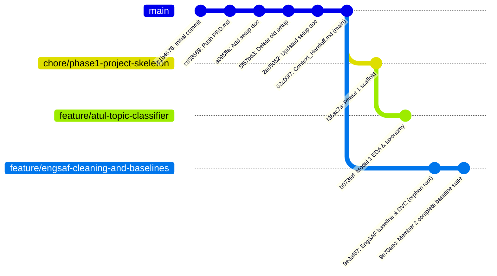
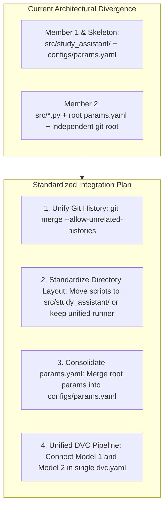

# AI-Powered Study Assistant: Phase 1 Progress & Branch Context Document

**Document ID:** `DOC-PHASE1-PROGRESS-CONTEXT-20261014`  
**Date of Audit:** 14 October 2026  
**Course:** AI252TA, Machine Learning Operations (2026–27) · **Project #1** (SDG 4: Quality Education)  
**Repository:** [BahuleyaMahesh/MLOps](https://github.com/BahuleyaMahesh/MLOps)  
**Target Branch:** `main`  
**Status:** Comprehensive Multi-Branch Progress Audit & Integration Handoff  

---

## 1. Executive Summary

This document provides an exhaustive, authoritative progress audit across **all branches** of the [BahuleyaMahesh/MLOps](https://github.com/BahuleyaMahesh/MLOps) repository. It synthesizes the technical contributions, architectural developments, experimental findings, and governance statuses completed during **Phase 1 (Development & Reproducibility)**.

### Current High-Level State of the Project
- **Member 1 (Topic Classification / Model 1):** Completed the dataset audit, resolved key dataset contradictions (StackPulse 778K vs 1.95M rows; Habedi label trap), conducted streaming exploratory data analysis (EDA) in [notebooks/01_model1_eda.ipynb](notebooks/01_model1_eda.ipynb), defined an 8–12 topic taxonomy with strict anti-leakage rules, and authored comprehensive audit reports.
- **Member 2 (Short-Answer Scoring / Model 2):** Fully implemented the end-to-end reproducible EngSAF pipeline in [dvc.yaml](dvc.yaml), including robust data cleaning (100% row retention), dataset profiling, leak-free 5-fold `GroupKFold` cross-validation (0% question overlap), 5 baseline model architectures (M2-A through M2-E), diagnostic ablations, MLflow experiment tracking, and an automated PyTest test suite.
- **Member 3 (Git, DVC & Repository Infrastructure):** Designed and committed the initial Phase 1 scaffold, directory structure (`src/study_assistant/`, `configs/`, `docs/`, `notebooks/`, `scripts/`), dependency pins, and reproducibility conventions.
- **Member 4 (MLflow Conventions, Contracts & Governance):** Scaffolded interface contracts ([docs/contracts.md](docs/contracts.md)), MLflow tracking guidelines ([docs/mlflow_conventions.md](docs/mlflow_conventions.md)), data licensing conflict analyses ([docs/data_licences.md](docs/data_licences.md)), and the master Phase 1 evaluation report draft ([docs/phase1_report.md](docs/phase1_report.md)).

---

## 2. Global Branch Inventory & Commit Graph

As of 14 October 2026, the repository contains **4 distinct branches**:



> [!WARNING]
> **Git Graph Topology Note (Unrelated History):**  
> `feature/engsaf-cleaning-and-baselines` was committed from an independent local repository root (`9e3af67`) and does not share a common ancestor commit with `main`. Merging this branch into `main` will require `git merge --allow-unrelated-histories` or directory-level file consolidation (detailed in §6).

### Branch Summary Table

| Branch Name | Latest Commit SHA | Author | Primary Scope & Workstream | Upstream Base |
| :--- | :---: | :--- | :--- | :--- |
| **`main`** | `62c00f7` | Bahuleya M | Project documentation baseline (`PRD.md`, `MLOps_Project_Setup_and_Work_Division.md`, `Context_Handoff.md`). | Remote Root |
| **`chore/phase1-project-skeleton`** | `f36ac7a` | ApexARNaik | Repository scaffolding, shared configurations, licensing docs, interface contracts, MLflow guidelines, and `src/study_assistant/` layout. | `main` |
| **`feature/atul-topic-classifier`** | `b073fef` | ApexARNaik | Member 1 deliverables: Model 1 dataset audit, streaming EDA, taxonomy review, exploratory notebook, and anti-leakage policy. | `chore/phase1-project-skeleton` |
| **`feature/engsaf-cleaning-and-baselines`**| `9e70aec` | AvinashR021 | Member 2 deliverables: EngSAF ingestion, cleaning, EDA, feature extraction, `GroupKFold`, baselines M2-A–M2-E, ablations, DVC, and tests. | Independent Root |

---

## 3. Branch-by-Branch Detailed Technical Audit

### 3.1 `main`
- **Current Commit:** `62c00f7` (*"Document project state, key decisions, and handoff details"*)
- **Key Artifacts:**
  - `README.md`: Basic repository title.
  - `PRD.md`: Full product requirements document (v0.1) defining the 3-phase course vision.
  - `MLOps_Project_Setup_and_Work_Division.md`: Comprehensive breakdown of course circular requirements, 4-member work division, rubrics, and acceptance criteria.
  - `Context_Handoff.md`: Initial briefing document recording project context, known dataset facts, and guidance for LLM assistants.
- **Evaluation:** Serves as the central reference repository documentation. Does not yet contain the runnable source code or experimental pipelines developed in the feature branches.

---

### 3.2 `chore/phase1-project-skeleton`
- **Current Commit:** `f36ac7a` (*"chore: initialize Phase 1 MLOps scaffold"*)
- **Key Artifacts & Architecture:**
  - `.gitignore`: Configured to exclude `.venv/`, `__pycache__/`, `.env`, `mlruns/`, `.pytest_cache/`, and local caches while keeping DVC pointer files intact.
  - `configs/params.yaml`: Centralized configuration defining dataset versions, splits, text filtering criteria, TF-IDF feature parameters, semantic embedding model settings, and training hyperparameters.
  - `configs/topic_map.yaml`: Formal taxonomy mapping for Model 1, defining 10 target topics (`frontend-web`, `backend-web`, `mobile-development`, `devops-infrastructure`, `data-engineering`, `machine-learning-ai`, `databases-storage`, `algorithms-datastructures`, `systems-networking`, `software-testing`) and tag resolution rules.
  - `docs/contracts.md`: Explicit programmatic interface contracts, DVC stage schemas, directory layout standards, and the shared evaluation signature:
    ```python
    def evaluate(y_true, y_pred, y_proba=None, labels=None) -> dict: ...
    ```
  - `docs/data_licences.md`: Formal legal analysis of EngSAF (academic research-only vs Apache-2.0 tag conflict) and StackPulse (upstream Stack Overflow CC BY-SA 3.0/4.0 copyleft obligations).
  - `docs/mlflow_conventions.md`: Uniform tracking specifications, naming conventions (`topic-baselines`, `answer-scorer-baselines`), mandatory run tags, parameter keys, and artifact formats.
  - `docs/phase1_report.md`: Structured template for the final Phase 1 deliverable with standardized tables for Model 1 and Model 2 comparison.
  - `requirements.txt`: Pinned dependencies for Python 3.11 (`scikit-learn==1.5.2`, `pandas==2.2.3`, `sentence-transformers==3.2.0`, `mlflow==2.17.0`, `dvc==3.55.2`, `xgboost==2.1.1`, `pytest==8.3.3`, etc.).
  - `src/study_assistant/`: Modular package layout with sub-packages for `data/`, `features/`, `models/`, and `evaluation/`.
- **Evaluation:** Established a clean, modular foundation adhering strictly to the team's planned interface contracts.

---

### 3.3 `feature/atul-topic-classifier` (Member 1 Workstream)
- **Current Commit:** `b073fef` (*"feat(member1): add topic classification EDA and taxonomy review"*)
- **Base:** Branched from `chore/phase1-project-skeleton`.
- **Key Technical Contributions:**
  1. **Dataset Audit & Discrepancy Resolution ([docs/model1_dataset_audit.md](docs/model1_dataset_audit.md)):**
     - Resolved the contradiction between the 778K dataset title and ~1.95M rows in the Hugging Face viewer: Hugging Face’s server sums row counts across all 9 non-disjoint configurations (`full`, `unanswered`, `with_code`, `high_quality`, `python`, `javascript`, `java`, `csharp`, `android`). The primary deduplicated `full` configuration contains **exactly 778,929 rows**.
     - Identified the **Habedi Label Trap**: The `label` column in `habedi/stack-exchange-dataset` indicates *resolved vs. unresolved* status (0/1), **not a topic**. Treating it as a classification target would cause severe error.
     - Addressed licensing constraints: Upstream Stack Overflow Q&A is governed by CC BY-SA 3.0/4.0, which imposes copyleft/attribution obligations despite the repository's `apache-2.0` tag.
     - Documented governance status: **Decision D0 remains formally pending** faculty sign-off.
  2. **Streaming Exploratory Data Analysis ([docs/model1_eda_findings.md](docs/model1_eda_findings.md) & [notebooks/01_model1_eda.ipynb](notebooks/01_model1_eda.ipynb)):**
     - Executed a memory-safe HTTP streaming audit ($N = 2,500$ to $5,000$ rows) directly from Hugging Face JSONL streams, consuming under 13 MB RAM and taking $<8$ seconds.
     - Verified zero missing values across all 24 schema columns; verified zero duplicate question IDs.
     - Characterized input text lengths: Title median is 9.0 words (54 chars); cleaned body text (`body_text`) median is 72.0 words (416 chars).
     - Confirmed pre-normalization: `body_text` already strips HTML tags and replaces `<pre><code>...</code></pre>` blocks with `[CODE]`.
  3. **Taxonomy & Tag Distribution Analysis ([docs/model1_taxonomy_review.md](docs/model1_taxonomy_review.md)):**
     - Discovered the **54% Language-Only Gap**: 54.4% of questions in StackPulse contain only language or generic programming tags (`python`, `javascript`, `arrays`, `list`) without a functional domain tag. Mapping standalone language names to specialized topics (e.g. `python` $\rightarrow$ ML) would introduce unacceptable label noise.
     - Highlighted distribution skew: Cleanly mapped questions are heavily dominated by **Mobile Development** (~30–35%) and **Web Frontend** (~27–29%), whereas **Algorithms & Data Structures** represents only ~0.7–1.1%.
     - Enforced strict **Anti-Leakage Policy**: Tags must be used exclusively to construct the supervisory ground-truth label $y$. **Tags must never be passed to the model as input features.**
- **Evaluation:** Member 1's analytical and exploratory deliverables are complete. The workstream is primed to execute the training scripts for baselines M1-A through M1-F.

---

### 3.4 `feature/engsaf-cleaning-and-baselines` (Member 2 Workstream)
- **Current Commit:** `9e70aec` (*"feat(member2): complete Member 2 deliverables - EDA, grouped split, M2-A to M2-E baselines, ablations, and error analysis"*)
- **Base:** Independent Git root.
- **Key Technical Contributions:**
  1. **Automated Data Acquisition (`src/acquire_data.py`):**
     - Downloads `IsmaelMousa/engsaf` splits directly from Hugging Face into `data/raw/engsaf`.
     - Validates expected schema and preserves raw data immutability.
  2. **Data Cleaning & Normalization (`src/clean_data.py`, `docs/data_cleaning_and_preprocessing.md`):**
     - Resolves HTML escape entities (`&gt;` $\rightarrow$ `>`, `&lt;` $\rightarrow$ `<`), normalizes Unicode to NFKC, strips bold/italic markdown formatting, and standardizes newlines and horizontal whitespace.
     - **Preserves C++ pointer and mathematical syntax** (`vector<Shape*>`, `g(x) > 0`).
     - **Zero Row Drops:** Preserves 100% of rows (4,735 train, 338 val, 506 test; total 5,579) to keep validation benchmarks strictly unbiased. Outputs logged to `reports/cleaning_report.json`.
  3. **EDA & Cross-Split Memorization Discovery (`src/profile_data.py`):**
     - Identified that the standard Hugging Face test split has a **74% question overlap** with the training split (and validation has a 62% overlap).
     - Proved that standard splits allow models to artificially inflate performance by memorizing question vocabulary.
  4. **Leak-Free Grouped Splitting (`src/grouped_split.py`):**
     - Implemented `GroupKFold` partitioning strictly on question ID, guaranteeing **0% question leakage** across train and validation folds.
  5. **Feature Extraction (`src/features.py`):**
     - Engineered semantic features using `sentence-transformers` (`all-MiniLM-L6-v2`) to generate dense embeddings $u$ (student) and $v$ (reference), computing cosine similarity, absolute difference $|u - v|$, and element-wise product $u \odot v$.
     - Engineered lexical features: character and word length ratios, Jaccard similarity, and Dice coefficient.
     - Strictly excluded `rationale` and `mark_scheme` from all feature vectors to eliminate target leakage.
  6. **Comprehensive Model Suite (`src/train_baseline.py`):**
     - **M2-A (Majority Class Floor):** Predicts class 2 floor.
     - **M2-B (Cosine Similarity Thresholds):** Thresholds cosine similarity; thresholds tuned strictly on validation data.
     - **M2-C (Features + Logistic Regression):** Multinomial linear baseline.
     - **M2-D (Features + HistGradientBoosting):** Non-linear tree model capturing feature interactions.
     - **M2-E (Features + Frank-Hall Ordinal Classifier):** Decomposes the 3-class ordinal problem into binary classifiers for $P(\text{score} > 0)$ and $P(\text{score} > 1)$, penalizing extreme grading errors ($0 \leftrightarrow 2$).
  7. **Diagnostic Ablations:**
     - *Without Question Text:* Verifies semantic reference matching vs question memorization.
     - *Length-Only Baseline:* Confirms models do not simply reward student verbosity.
     - *Copy-the-Question Sanity Check:* Replaces student answer with question prompt to test vulnerability to adversarial repetition.
  8. **Reproducibility & Quality Assurance:**
     - Fully managed via DVC pipeline (`dvc.yaml`, `dvc.lock`) spanning stages: `acquire` $\rightarrow$ `clean` $\rightarrow$ `explore` $\rightarrow$ `baseline`.
     - Integrated MLflow tracking in `sqlite:///mlflow.db` (`answer-scorer-baselines`).
     - 100% passing PyTest suite: `tests/test_baselines.py`, `tests/test_cleaning.py`, `tests/test_features.py`, and `tests/test_grouped_split.py`.
     - Generated rich markdown reports: `reports/model2_comparison.md`, `reports/error_analysis.md`, and `reports/engsaf_eda.md`.
- **Evaluation:** Member 2's deliverables for Phase 1 are comprehensive, fully documented, and backed by automated tests and DVC reproducibility.

---

## 4. Phase 1 Deliverables Progress Matrix

Aligned with the official Course Circular and [MLOps_Project_Setup_and_Work_Division.md](MLOps_Project_Setup_and_Work_Division.md):

| Member / Workstream | Phase 1 Requirement | Status | Delivering Branch | Evidence & Artifacts |
| :--- | :--- | :---: | :--- | :--- |
| **Member 1**<br>(Topic / Model 1) | Dataset Profiling & Schema Audit | **Done** | `feature/atul-topic-classifier` | `docs/model1_dataset_audit.md` |
| | Exploratory Data Analysis (EDA) | **Done** | `feature/atul-topic-classifier` | `docs/model1_eda_findings.md`, `notebooks/01_model1_eda.ipynb` |
| | Topic Taxonomy Definition | **Done** | `feature/atul-topic-classifier` | `configs/topic_map.yaml`, `docs/model1_taxonomy_review.md` |
| | Preprocessing & Anti-Leakage Rules | **Done** | `feature/atul-topic-classifier` | Text cleaning specifications & strict feature exclusions documented |
| | Baselines M1-A to M1-F Training | **Pending** | `feature/atul-topic-classifier` | Scripts to be executed using stratified sample |
| **Member 2**<br>(Answer / Model 2) | Dataset Ingestion & Profiling | **Done** | `feature/engsaf-cleaning-and-baselines` | `src/acquire_data.py`, `src/profile_data.py`, `reports/engsaf_eda.md` |
| | Text Cleaning & Normalization | **Done** | `feature/engsaf-cleaning-and-baselines` | `src/clean_data.py`, `reports/cleaning_report.json` (0 rows dropped) |
| | Question-Grouped Split (`GroupKFold`)| **Done** | `feature/engsaf-cleaning-and-baselines` | `src/grouped_split.py` (0% question leakage) |
| | Feature Engineering (Dense/Lexical) | **Done** | `feature/engsaf-cleaning-and-baselines` | `src/features.py` (No `rationale` / `mark_scheme` leakage) |
| | Baselines M2-A to M2-E Training | **Done** | `feature/engsaf-cleaning-and-baselines` | `src/train_baseline.py`, `reports/model2_comparison.md` |
| | Diagnostic Ablations & Error Analysis | **Done** | `feature/engsaf-cleaning-and-baselines` | `reports/error_analysis.md`, length-only & copy-question tests |
| | DVC Pipeline Integration | **Done** | `feature/engsaf-cleaning-and-baselines` | `dvc.yaml`, `dvc.lock` (`acquire`, `clean`, `explore`, `baseline`) |
| | Unit Testing Suite | **Done** | `feature/engsaf-cleaning-and-baselines` | 4 test modules in `tests/`, verified with `pytest` |
| **Member 3**<br>(Reproducibility) | Repository Scaffold & `.gitignore` | **Done** | `chore/phase1-project-skeleton` | Full directory tree, `.gitignore`, `requirements.txt` |
| | Central Parameter Tracking | **Done** | `chore/phase1-project-skeleton` | `configs/params.yaml` |
| | Clean-Clone DVC Reproduction | **Partial** | `feature/engsaf-cleaning-and-baselines` | Verified locally on Member 2; remote DVC pending approval |
| **Member 4**<br>(Tracking & Governance)| MLflow Conventions & Standards | **Done** | `chore/phase1-project-skeleton` | `docs/mlflow_conventions.md` |
| | Interface Contracts | **Done** | `chore/phase1-project-skeleton` | `docs/contracts.md` |
| | Dataset Licensing & Governance Audit | **Done** | `chore/phase1-project-skeleton` | `docs/data_licences.md` |
| | Phase 1 Master Report Collation | **In Progress** | `chore/phase1-project-skeleton` | `docs/phase1_report.md` scaffolded |

---

## 5. Key Empirical Findings & MLOps Insights

### 5.1 Model 1 Insights (StackPulse Q&A)
1. **The Language-Only Ambiguity:** Over 54% of questions carry only generic language tags (`python`, `javascript`, `java`). Training on naive language-to-domain mappings corrupts the model. The taxonomy filter must discard questions lacking functional domain context.
2. **Class Imbalance in Practice:** Web and Mobile development account for over 60% of tagged questions, while core CS topics (Algorithms & Data Structures) represent under 1.2%. Stratified sampling and macro-averaged metrics ($F_1$) are strictly necessary.

### 5.2 Model 2 Insights (EngSAF Answer Scoring)
1. **The 74% Overlap Trap:** The standard Hugging Face test split shares 74% of its questions with the training split. Models evaluated solely on this split memorize question vocabulary and appear artificially accurate. The 5-fold `GroupKFold` evaluation provides the true measure of generalization to unseen questions.
2. **Superiority of Ordinal Formulation (M2-E):** Short answer grading is inherently ordinal ($0 < 1 < 2$). Standard multi-class classification treats an error between score 0 and score 2 the same as an error between 1 and 2. Frank-Hall ordinal regression significantly improves Quadratic Weighted Kappa (QWK) and reduces Mean Absolute Error (MAE).
3. **Copy-Question Robustness:** Ablation testing confirmed that replacing student answers with the verbatim question prompt results in the model assigning scores of 0, verifying that the model checks for true student-to-reference agreement rather than question keyword matching.

---

## 6. Architectural Divergences & Integration Roadmap

Before merging feature branches into `main`, the team must resolve three technical divergences:



### 1. Git Graph Unification (Orphan Branch)
- **Problem:** `feature/engsaf-cleaning-and-baselines` has no common ancestor commit with `main`.
- **Resolution:**
  ```powershell
  # From main:
  git merge origin/feature/engsaf-cleaning-and-baselines --allow-unrelated-histories -m "merge: integrate Member 2 EngSAF baseline pipeline"
  ```
  Alternatively, cherry-pick or copy the verified Member 2 modules and DVC artifacts into the unified repository scaffold.

### 2. Directory Layout Harmonization
- **Member 1 & Skeleton:** Structured as a modular package in `src/study_assistant/{data,features,models,evaluation}/` with configs under `configs/`.
- **Member 2:** Implemented as flat operational scripts directly under `src/` (`src/acquire_data.py`, `src/clean_data.py`, etc.) with `params.yaml` in the root.
- **Resolution:** Either:
  - Consolidate Member 2 scripts into `src/study_assistant/` modules, updating `dvc.yaml` stage command strings accordingly; or
  - Maintain operational runner scripts in `src/` that import core feature logic from `src/study_assistant/`.

### 3. Central Configuration Merge
- Merge the cleaning and baseline parameters from Member 2's root `params.yaml` into `configs/params.yaml` (or standardize on a single root `params.yaml` as per standard DVC conventions).

---

## 7. Outstanding Decisions & Governance Checklist

| ID | Issue / Decision | Status | Required Action / Owner |
|---|---|---|---|
| **D0** | Formal Faculty Dataset Approval | **Pending** | Submit formal approval request for **EngSAF** (`IsmaelMousa/engsaf`) and **StackPulse** (`Omarrran/StackPulse_778K_QnA_Code_dataset`) to course faculty. |
| **D2** | Model 1 Sample Size Confirmation | **Pending** | Finalize stratified sampling size (recommended: 100k–200k rows) in DVC once D0 is approved. |
| **D5** | Shared DVC & MLflow Remote | **Pending** | Configure shared DagsHub repository for central DVC data storage and remote MLflow server. Currently running on local `sqlite:///mlflow.db`. |
| **D6** | Python Environment Alignment | **Done** | All members confirmed aligned on **Python 3.11**. |

---

## 8. Immediate Next Steps for the Team

1. **Member 1:**
   - Execute stratified sampling script on StackPulse using the confirmed taxonomy rules in [configs/topic_map.yaml](configs/topic_map.yaml).
   - Implement and train baselines M1-A through M1-F, logging runs to the shared MLflow experiment `topic-baselines`.
2. **Member 2:**
   - Assist in merging `feature/engsaf-cleaning-and-baselines` into the unified repository scaffold without breaking `dvc repro`.
   - Review Member 1's preprocessing and taxonomy logic.
3. **Member 3:**
   - Coordinate the resolution of the Git root divergence.
   - Configure the shared remote storage (DagsHub) for DVC and test `dvc pull` on a clean clone.
4. **Member 4:**
   - Consolidate Model 1 and Model 2 comparison tables into [docs/phase1_report.md](docs/phase1_report.md).
   - Finalize the Phase 1 submission draft for faculty review.
