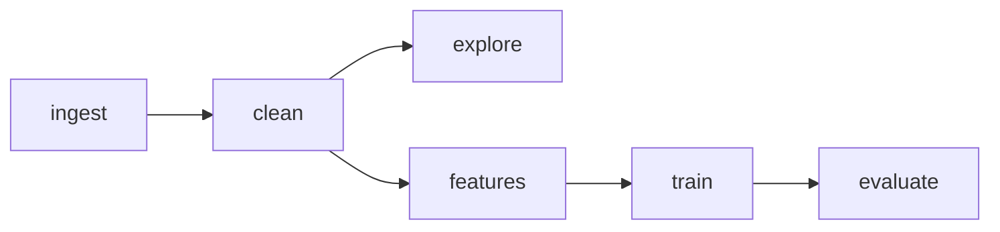

# AI-Powered Study Assistant — Phase 1

[](https://github.com/BahuleyaMahesh/MLOps/actions/workflows/ci.yml)
[](dvc.yaml)
[](notebooks/colab_reproducibility.ipynb)
[](requirements.txt)
[](https://github.com/psf/black)

Phase 1 explores the EngSAF short-answer grading dataset, establishes rigorous data cleaning protocols, builds candidate baseline models (M2-A through M2-E), prevents data leakage via 5-fold `GroupKFold` cross-validation on question IDs, and builds a fully reproducible MLOps backbone with Git, DVC, and MLflow.

---

## 1. Quick Start: Clean-Clone Setup

To reproduce the entire pipeline on a clean machine:

### Prerequisites
- Python 3.10 or 3.11 (Python 3.11 recommended)
- Git and DVC installed

### Step-by-Step Instructions

1. **Clone the repository**:
   ```powershell
   git clone https://github.com/BahuleyaMahesh/MLOps.git AI-Powered-Study-Assistant
   cd AI-Powered-Study-Assistant
   ```

2. **Create and activate a virtual environment**:
   ```powershell
   python -m venv venv
   .\venv\Scripts\Activate.ps1
   ```

3. **Install exact pinned dependencies**:
   ```powershell
   python -m pip install --upgrade pip
   pip install -r requirements.txt
   pip install -r requirements-dev.txt
   ```

4. **Pull versioned data or reproduce the entire pipeline**:
   ```powershell
   # To pull cached data from DVC remote:
   dvc pull

   # To execute all pipeline stages from scratch:
   dvc repro
   ```

5. **Verify reproducibility and run the test suite**:
   ```powershell
   # Run all 29 automated unit, schema, and security tests:
   pytest -v tests/

   # Run the independent numerical reproducibility audit (tolerance Δ ≤ 0.001):
   python -m src.reproducibility_check
   ```

---

## 2. Google Colab Template

Run the entire pipeline in the cloud with one click using the interactive notebook:
👉 **[notebooks/colab_reproducibility.ipynb](notebooks/colab_reproducibility.ipynb)**

---

## 3. Modular DVC Pipeline Architecture

The pipeline is partitioned into 5 decoupled stages defined in [`dvc.yaml`](dvc.yaml):



1. **`ingest` (`python -m src.acquire_data`)**:
   Downloads the official EngSAF split files pinned to Hugging Face commit SHA `0a2b17a` into local DVC storage (`data/raw/engsaf/`).
2. **`clean` (`python -m src.clean_data`)**:
   Cleans HTML entities, standardizes whitespace/newlines, strips Markdown bold/italics while strictly preserving programming code syntax and math symbols into `data/processed/engsaf/` (see [`docs/data_cleaning_and_preprocessing.md`](docs/data_cleaning_and_preprocessing.md)).
3. **`explore` (`python -m src.profile_data`)**:
   Computes comprehensive schema, score distribution, and cross-split question overlap statistics into [`reports/data_profile.json`](reports/data_profile.json) and [`reports/engsaf_eda.md`](reports/engsaf_eda.md).
4. **`features` (`python -m src.extract_features`)**:
   Extracts lexical overlap, character/word length ratios, and dense TruncatedSVD semantic interaction features (`data/features/engsaf/`) with strict verification ensuring `rationale` and `mark_scheme` never leak.
5. **`train` (`python -m src.train`)**:
   Fits candidate scoring architectures and serializes trained models into [`models/`](models/):
   - **M2-A (Majority Class Baseline)**: Class 2 majority floor.
   - **M2-B (Cosine Similarity Thresholds)**: Validation-tuned token TF-IDF thresholds.
   - **M2-C (Engineered Features + Logistic Regression)**: Regularized linear classifier over engineered features.
   - **M2-D (HistGradientBoosting Classifier)**: Non-linear tree boosting over numerical features.
   - **M2-E (Ordinal Regression / Frank-Hall)**: Ordinal decomposition over discrete score thresholds.
6. **`evaluate` (`python -m src.evaluate`)**:
   Evaluates all models on the held-out test split, runs 5-fold `GroupKFold` cross-validation partitioned strictly by question ID (0% question leakage), executes diagnostic ablations, and generates:
   - [`reports/baseline_metrics.json`](reports/baseline_metrics.json)
   - [`reports/model2_comparison.md`](reports/model2_comparison.md)
   - [`reports/error_analysis.md`](reports/error_analysis.md)

---

## 4. DVC Remote Storage Configuration

The project tracks data and model binaries via DVC. A local remote is configured by default:

```powershell
# View configured remotes:
dvc remote list

# Push artifacts to remote:
dvc push

# Pull artifacts from remote:
dvc pull
```

To configure a cloud remote (AWS S3, Google Cloud Storage, or Azure Blob):
```powershell
dvc remote add -d s3_remote s3://my-mlops-bucket/dvc_storage
```

---

## 5. Experiment Tracking with MLflow

To launch the MLflow UI and explore tracked runs, parameters, metrics, and confusion matrix comparisons:

```powershell
mlflow ui --backend-store-uri sqlite:///mlflow.db
```

See [`docs/mlflow_conventions.md`](docs/mlflow_conventions.md) for standard naming schemas, run tags, and model registry aliases (`@Candidate`, `@Challenger`, `@Production`).

---

## 6. Baseline Performance Summary

| Model ID | Architecture | Test Macro-F1 (Std Split) | Test QWK (Std Split) | GroupKFold Macro-F1 (Mean ± Std) | GroupKFold QWK (Mean ± Std) | Status |
|---|---|---|---|---|---|---|
| `M2-A` | Majority Floor | 0.1902 | 0.0000 | 0.2000 ± 0.0163 | 0.0000 ± 0.0000 | Baseline Floor |
| `M2-B` | Cosine Thresholds | 0.4990 | 0.3439 | 0.4334 ± 0.0401 | 0.2687 ± 0.0416 | Fast Lexical Baseline |
| `M2-C` | Logistic Regression | **0.5141** | 0.4292 | 0.5016 ± 0.0275 | 0.3749 ± 0.0263 | **Main Baseline** |
| `M2-D` | HistGradientBoosting | 0.5160 | **0.4394** | **0.5131 ± 0.0152** | **0.3747 ± 0.0195** | **Top Non-Linear Model** |
| `M2-E` | Frank-Hall Ordinal | 0.4608 | 0.4262 | 0.4583 ± 0.0253 | 0.3678 ± 0.0267 | Ordinal Baseline |

*Key finding: GroupKFold cross-validation without question leakage reveals ~10–15% drop in QWK compared to standard random splits, demonstrating that question overlap inflates baseline evaluation.*

---

## 7. Phase 1 Work Division Deliverables Matrix

| Member / Workstream | Core Responsibilities | Key Deliverables & Files | Status |
|---|---|---|---|
| **Member 1**: Topic Data + Model 1 | Taxonomy, StackPulse EDA, Text Cleaning, M1-A to M1-F | `topic_map.yaml`, `src/model1/`, M1 MLflow runs | Ongoing |
| **Member 2**: Answer Data + Model 2 | EngSAF profiling, GroupKFold, Feature engineering, M2-A to M2-E, Error Analysis | [`src/features.py`](src/features.py), [`src/grouped_split.py`](src/grouped_split.py), [`reports/model2_comparison.md`](reports/model2_comparison.md) | **100% Completed** |
| **Member 3**: MLOps Backbone | Repo skeleton, DVC remote, 5-stage `dvc.yaml`, PR template, CI/CD, dependency pinning, Colab, reproducibility audit | [`.github/`](.github/), [`dvc.yaml`](dvc.yaml), [`docs/branch_rules.md`](docs/branch_rules.md), [`notebooks/colab_reproducibility.ipynb`](notebooks/colab_reproducibility.ipynb), [`reports/reproducibility_report.md`](reports/reproducibility_report.md) | **100% Completed** |
| **Member 4**: Integration & Serving | FastAPI service, Docker, Evidently drift, Prometheus monitoring | `src/api/`, `Dockerfile`, `docker-compose.yml`, monitoring dashboard | Scheduled Phase 2 |

---

## 8. Baseline Safeguards & Licensing

- **Target Leakage Safeguard**: `rationale` and `mark_scheme` are strictly excluded from input features.
- **Licensing Notice**: Dataset usage adheres to academic evaluation terms; see [`docs/data_licences.md`](docs/data_licences.md).
