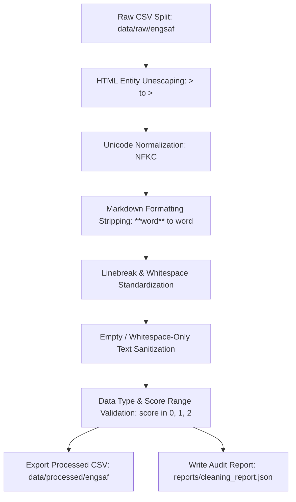

# Data Cleaning and Preprocessing Documentation

## 1. Overview and Objectives

This document details the data cleaning and preprocessing pipeline implemented for the EngSAF short-answer scoring dataset (`IsmaelMousa/engsaf`).

The objective is to transform noisy, uncurated raw text entries into clean, standardized text while:
1. **Preserving Domain-Specific Syntax**: Retaining critical technical and mathematical notation (e.g., C++ template brackets `vector<Shape*>`, member resolution `::`, file descriptors `fd[0]`, pointer asterisks `Shape*`, and math operators `g(x) > 0`, `S <= 0.95`).
2. **Standardizing Whitespace and Linebreaks**: Normalizing irregular spacing, trailing whitespaces, carriage returns, and excessive blank lines.
3. **Resolving Encoding and Formatting Artifacts**: Unescaping raw HTML entities (`&gt;` -> `>`) and stripping Markdown formatting markers (`**TRUE**` -> `TRUE`).
4. **Enforcing Strict Data Integrity**: Guaranteeing 0 row drops so that test and validation benchmark splits remain strictly comparable across all modeling phases.
5. **Ensuring Pipeline Reproducibility and Versioning**: Fully integrating the cleaning step as a DVC stage tracked in `dvc.yaml` and parameter-controlled in `params.yaml`.

---

## 2. Exploratory Findings (The "Why")

Prior to cleaning, an audit of the raw data (`data/raw/engsaf/`) revealed several categories of noise:

| Issue Type | Raw Symptom | Example Found in Dataset | Impact on Modeling |
| :--- | :--- | :--- | :--- |
| **HTML Entities** | Unescaped HTML escape sequences | `multiple hidden layers (&gt;1 layer) desirable?` | Fractures tokens and causes tokenizers to learn spurious entity n-grams (`&gt;`). |
| **Markdown Markers** | Bold/italic markers in student responses | `**TRUE**, context switch allows **syscalls**` | Adds punctuation noise to similarity, token overlap, and character n-grams. |
| **Surrounding Whitespace** | Thousands of lines with leading/trailing spaces | `' True\n...'` or `'Question text [4 marks]:      '` | Inconsistent string equality checks and inaccurate length ratios. |
| **Multiple Spaces & Tabs** | Runaway horizontal spaces within sentences | `'Write three      parameters which      affect...'` | Disrupts whitespace tokenization and regex matching. |
| **Irregular Linebreaks** | Mixed Windows (`\r\n`) and Unix (`\n`) newlines | Multiple trailing or middle carriage returns | Inconsistent string representations across operating systems. |
| **Blank Responses** | Whitespace-only student answers | Row 3952 (`\n\n`) scoring 0 | Can trigger NaN or false-token bugs in text feature extractors. |

---

## 3. Step-by-Step Preprocessing Pipeline

The module [src/clean_data.py](../src/clean_data.py) executes the following sequential transformations:



### Step 1: HTML Entity Unescaping
- **Implementation**: Uses Python's standard `html.unescape()` function.
- **Result**: Resolves entity codes such as `&gt;` into `>`, `&lt;` into `<`, and `&amp;` into `&`.
- **Safety**: Does not strip brackets or alter valid mathematical inequality symbols.

### Step 2: Unicode Normalization
- **Implementation**: Applies `unicodedata.normalize("NFKC", text)`.
- **Result**: Standardizes full-width characters, ligature forms, and compatibility variants into standard Unicode characters.

### Step 3: Markdown Formatting Stripping
- **Implementation**: Uses regex substitutions:
  - `\*\*(.+?)\*\*` $\rightarrow$ `\1`
  - `__(.+?)__` $\rightarrow$ `\1`
- **Result**: Converts `**TRUE**` to `TRUE` and `__important__` to `important`.
- **Safety**: Leaves single asterisks (`*`) untouched to maintain C++ pointer syntax (e.g., `vector<Shape*>`, `Shape*`) and mathematical multiplications.

### Step 4: Linebreak and Whitespace Standardization
- **Implementation**:
  1. Standardizes carriage returns: replaces `\r\n` and `\r` with standard Unix `\n`.
  2. Collapses horizontal whitespace: replaces `[ \t]+` with a single space `' '` on each line.
  3. Trims whitespace at line boundaries.
  4. Collapses excessive blank lines: collapses `\n{3,}` down to at most `\n\n` (standard paragraph separation).
  5. Strips outer leading and trailing whitespace from the full text.

### Step 5: Empty and Whitespace-Only Text Sanitization
- **Implementation**: Any answer or question that evaluates to empty after whitespace trimming is cleanly mapped to an empty string `""` rather than remaining as dangling whitespace or newline characters.

### Step 6: Column Typing and Label Validation
- **Implementation**:
  - Enforces presence of all required columns: `question`, `student_answer`, `reference_answer`, `mark_scheme`, `score`, and `rationale`.
  - Asserts that all `score` values are non-null and fall strictly within `{0, 1, 2}`.
  - Casts `score` explicitly to `int64`.
  - Zero rows dropped: all 4,735 train, 338 validation, and 506 test rows are preserved.

---

## 4. Cleaning Audit Report Summary

The cleaning run generated [reports/cleaning_report.json](../reports/cleaning_report.json), tracking every modification:

| Split | Total Rows | Questions Cleaned | Student Answers Cleaned | Reference Answers Cleaned | HTML Entities Resolved | Markdown Markers Cleaned | Empty Answers Handled |
| :--- | :---: | :---: | :---: | :---: | :---: | :---: | :---: |
| **Train** | 4,735 | 1,529 | 1,717 | 839 | 52 | 109 | 1 |
| **Validation** | 338 | 89 | 85 | 124 | 0 | 15 | 0 |
| **Test** | 506 | 145 | 125 | 189 | 2 | 0 | 0 |
| **Total** | **5,579** | **1,763** | **1,927** | **1,152** | **54** | **124** | **1** |

> [!NOTE]
> 100% of rows were retained across all splits. Test and validation set benchmarks remain unbiased and directly comparable across all pipeline runs.

---

## 5. DVC Pipeline Integration

The DVC pipeline configuration in [dvc.yaml](file:///c:/Users/avina_lxw1l2h/Documents/AI-Powered%20Study%20Assistant/dvc.yaml) now includes the `clean` stage:

```yaml
stages:
  acquire:
    cmd: python -m src.acquire_data
    deps:
      - src/acquire_data.py
      - params.yaml
    outs:
      - data/raw/engsaf
  clean:
    cmd: python -m src.clean_data
    deps:
      - src/clean_data.py
      - data/raw/engsaf
      - params.yaml
    outs:
      - data/processed/engsaf
      - reports/cleaning_report.json
  explore:
    cmd: python -m src.profile_data
    deps:
      - src/profile_data.py
      - data/processed/engsaf
    outs:
      - reports/data_profile.json
  baseline:
    cmd: python -m src.train_baseline
    deps:
      - src/features.py
      - src/train_baseline.py
      - data/processed/engsaf
      - params.yaml
    outs:
      - reports/baseline_metrics.json
```

### Parameter Tracking in `params.yaml`

Cleaning flags are tracked in [params.yaml](file:///c:/Users/avina_lxw1l2h/Documents/AI-Powered%20Study%20Assistant/params.yaml) under `preprocessing`:

```yaml
preprocessing:
  unescape_html: true
  normalize_unicode: true
  normalize_whitespace: true
  clean_markdown_formatting: true
```

---

## 6. Testing and Quality Assurance

A dedicated unit test suite was added to [tests/test_cleaning.py](file:///c:/Users/avina_lxw1l2h/Documents/AI-Powered%20Study%20Assistant/tests/test_cleaning.py) verifying:
1. `test_clean_text_unescapes_html_entities`: Validates unescaping of `&gt;`, `&lt;`, `&amp;`.
2. `test_clean_text_normalizes_whitespace_and_newlines`: Validates CRLF conversion, horizontal space collapsing, and paragraph newline collapsing.
3. `test_clean_text_handles_empty_and_none`: Ensures `None`, `""`, and whitespace-only inputs map safely to `""`.
4. `test_clean_text_cleans_markdown_bold_and_italics`: Ensures `**bold**` and `__italics__` are stripped.
5. `test_clean_text_preserves_code_syntax_and_math_operators`: Verifies that C++ constructs (`vector<Shape*>`, `Shape*`, `draw()`) and math inequalities (`g(x) > 0`, `S <= 0.95`) remain intact.
6. `test_clean_split_validates_scores_and_missing_columns`: Ensures invalid score labels or missing columns raise descriptive errors.
7. `test_clean_split_processes_data_and_counts_modifications`: Verifies statistics tracking and transformations.
8. `test_clean_dataset_end_to_end`: Validates directory-level CSV reading, cleaning, and output generation.

Run tests at any time with:
```powershell
pytest
```

---

## 7. How to Run and Reproduce

### Run the Cleaning Stage Independently
```powershell
python -m src.clean_data
```

### Run the Entire End-to-End Pipeline
```powershell
dvc repro
```
This will automatically execute `acquire` $\rightarrow$ `clean` $\rightarrow$ `explore` $\rightarrow$ `baseline`, track model metrics in MLflow, and update `dvc.lock`.
